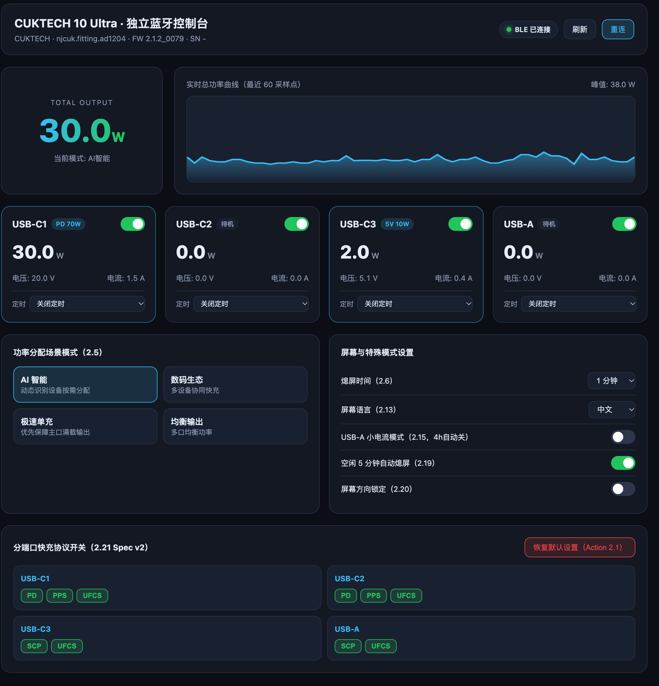

# CUKTECH 10 Ultra 独立离线蓝牙客户端

> **免责声明（Disclaimer）**：本项目为个人开源的**第三方非官方工具**，与酷态科（CUKTECH）及小米（Xiaomi / Mi Home）无任何官方关联、授权或合作关系。相关产品名称与商标仅用于指代兼容硬件。本项目仅供用户对自己合法拥有的硬件设备进行本地离线控制与协议互操作研究使用，请自行评估并承担对充电设备执行开关断电、协议调整及恢复出厂设置等操作的风险。

脱离米家 App，直接通过电脑蓝牙（macOS / Linux / Windows）连接并控制 **酷态科10号超级电能充Ultra（`AD1204U` / `njcuk.fitting.ad1204`）**。

- **100% 本地离线直连 BLE**：首次获取 12 字节设备 BLE Token 后，不再依赖小米云端与米家 App。
- **双交互前端**：Rich 终端 CLI（支持实时 `watch`）+ 零外部 CDN 的本地 Web 实时功率仪表盘。
- **完整协议文档 & Python SDK**：底层实现 MiBLE `0xFE95` 分包、Standard Auth（HKDF-SHA256 + AES-128-CCM）与 MIoT-BLE Spec v2，详见 [docs/PROTOCOL.md](docs/PROTOCOL.md)。



---

## 支持设备与运行环境

| 项目 | 说明 |
| --- | --- |
| 支持型号 | 酷态科10号超级电能充Ultra（`njcuk.fitting.ad1204` / `AD1204U`，兼容 `njcuk.fitting.1204e`） |
| 操作系统 | macOS（CoreBluetooth）、Linux（BlueZ）、Windows（WinRT） |
| Python 版本 | Python 3.11+ |

---

## 项目结构

```text
.
├── cuktech_ultra/
│   ├── __init__.py       # Python SDK 公共导出
│   ├── __main__.py       # 支持 `python -m cuktech_ultra`
│   ├── crypto.py         # Standard Auth HKDF-SHA256 / HMAC-SHA256 / AES-128-CCM
│   ├── parcel.py         # MiBLE 多包/单包分帧与 ACK 状态机
│   ├── spec.py           # MIoT-BLE Spec v2 二进制帧编解码
│   ├── device.py         # 酷态科 10 Ultra 属性表、位域编解码与 MiBeacon 解析
│   ├── ble_client.py     # 基于 bleak 的异步 BLE 客户端与扫描发现
│   ├── config.py         # 本地配置读写 (~/.cuktech-ultra/config.json)
│   ├── xiaomi_cloud.py   # 一次性小米账号扫码获取设备 MAC 与 BLE Token
│   ├── mock_device.py    # 全协议仿真外设 (--mock 体验模式与端到端测试)
│   ├── cli.py            # Rich + Typer 命令行工具
│   ├── web.py            # FastAPI + WebSocket 本地后端
│   └── static/index.html # 零依赖本地 Web 实时仪表盘
├── docs/
│   ├── PROTOCOL.md       # 完整 BLE 通信协议技术文档
│   └── preview.png       # 本地 Web 控制台界面预览
├── tests/                # 单元测试与端到端协议测试
├── pyproject.toml
└── LICENSE
```

---

## 安装

推荐使用 [`uv`](https://docs.astral.sh/uv/)（也完全支持标准 `venv + pip`）：

```bash
# 方式一：uv
uv venv .venv
source .venv/bin/activate      # Windows: .venv\Scripts\activate
uv pip install -e .

# 方式二：标准 Python venv + pip
python3 -m venv .venv
source .venv/bin/activate
pip install -e .
```

> 如需运行测试，安装开发依赖：`pip install -e ".[dev]"`。

---

## 快速体验（无需真机）

内置了完整协议栈的模拟充电器，不连真机即可预览 CLI 与 Web 面板：

```bash
cuktech-ultra status --mock
cuktech-ultra watch --mock
cuktech-ultra web --mock   # 浏览器访问 http://127.0.0.1:8765
```

---

## 连接真实充电器（首次配置，后续 100% 离线）

酷态科 10 Ultra 采用小米 MiBLE Standard Auth 加密握手，客户端需要持有该设备的 **12 字节 BLE Token（24 位十六进制）**。该密钥只需获取一次，保存在本机 `~/.cuktech-ultra/config.json`（权限 `0600`），之后可完全断网、脱离米家 App 使用。

### 第一步：扫描附近充电器

```bash
cuktech-ultra scan
```

正常会看到类似输出：
- 名称：`njcuk.fitting.ad1204`
- `PDID`：`26126`
- `MiBeacon MAC`：如 `AA:BB:CC:DD:EE:FF`
- `BLE 地址 / UUID`：macOS 上为 CoreBluetooth UUID，Linux/Windows 上为蓝牙 MAC

### 第二步：获取并保存 BLE Token（二选一）

- **方式 A（可选便捷辅助）：一次性小米账号扫码拉取**
  ```bash
  cuktech-ultra auth-qr
  ```
  按提示用手机打开链接或米家 App 扫码确认，程序会自动拉取设备的 `MAC` 与 24 位 `StandardAuth Token`，并尝试扫描关联本机蓝牙地址，保存到 `~/.cuktech-ultra/config.json`（不保存小米账号密码或 Cookie）。如不希望通过本工具登录云端，可改用方式 B 直接填入已有 Token。

- **方式 B：手动配置（已有 Token 时）**
  ```bash
  cuktech-ultra configure --mac AA:BB:CC:DD:EE:FF --token <24位十六进制Token>
  # macOS 可顺便填入 scan 扫到的 CoreBluetooth UUID 以加速直连：
  cuktech-ultra configure --address <CoreBluetooth-UUID>
  ```
  > 注意：StandardAuth 握手使用的是 **24 位 `token`（12 字节）**，不是 32 位 `beaconkey`（后者仅用于解密广播）。为避免命令行参数残留在 Shell 历史记录中，也可直接手动编辑 `~/.cuktech-ultra/config.json`（权限建议设为 `0600`）。

### 第三步：离线使用

```bash
# 查看四口实时电压/电流/功率、握手协议与当前设置
cuktech-ultra status

# 终端实时刷新监控（Ctrl+C 退出）
cuktech-ultra watch

# 启动本地 Web 实时仪表盘（http://127.0.0.1:8765）
cuktech-ultra web
```

---

## 全部 CLI 命令一览

所有控制命令均支持 `--address`、`--mac`、`--token` 覆盖本地配置，以及 `--mock` 模拟模式：

```bash
# 功率分配场景模式：ai(AI智能) / eco(数码生态) / turbo(极速单充) / balanced(均衡输出)
cuktech-ultra mode turbo

# 单口独立开关：c1 / c2 / c3 / a
cuktech-ultra port c2 off
cuktech-ultra port c2 on

# 单口定时关闭（单位：分钟；0 表示取消定时）
cuktech-ultra timer c1 120
cuktech-ultra timer c1 0

# USB-A 小电流模式（开启后 4 小时自动关闭）
cuktech-ultra usb-a-trickle on

# 屏幕设置：熄屏时间 (1m/5m/10m/30m/always)、语言 (zh/en)、空闲熄屏、方向锁定
cuktech-ultra screen --timeout 10m --lang zh --idle-off --no-dir-lock

# 分端口快充协议开关（需固件 >= 2.1.2_0040）
# c1/c2 支持 pd/pps/ufcs；c3/a 支持 scp/ufcs
cuktech-ultra protocol c1 pps on
cuktech-ultra protocol c3 scp off

# 恢复默认设置（Action 2.1）
cuktech-ultra reset
```

也可以通过 `python -m cuktech_ultra ...` 调用。

---

## Web 控制台 API 概览

启动 `cuktech-ultra web --host 127.0.0.1 --port 8765` 后，除浏览器仪表盘外还提供本地 HTTP / WebSocket 接口，便于接入个人脚本或自动化：

> **安全提示**：本地 Web 服务与 `/ws` 接口默认不启用身份鉴权，请保持仅监听 `127.0.0.1`，**切勿直接通过 `--host 0.0.0.0` 暴露到公网或不可信局域网**，避免他人远程操作端口开关或重置设备。

- `GET /api/health` — 连接状态检查
- `GET /api/state` — 获取完整状态 JSON（四口遥测、总功率、所有配置项）
- `WS /ws` — 实时状态推送（收到设备 `001B` 通知或操作变更时自动广播）
- `POST /api/connect` / `POST /api/refresh` — 重连 / 手动刷新
- `POST /api/mode` `{"mode": 1..4}` — 切换场景模式
- `POST /api/port` `{"port": "c1", "enabled": true}` — 单口开关
- `POST /api/timer` `{"port": "c1", "minutes": 60}` — 定时关闭
- `POST /api/screen` — 屏幕熄屏时间/语言/空闲熄屏/方向锁定
- `POST /api/usb-a-trickle` `{"enabled": true}` — USB-A 小电流模式
- `POST /api/protocol/v2` / `POST /api/protocol/v1` — 协议开关
- `POST /api/reset` — 恢复默认设置

---

## Python SDK 示例

```python
import asyncio
from cuktech_ultra import BleakTransport, CuktechUltraClient, SceneMode

async def main():
    transport = BleakTransport(mac="AA:BB:CC:DD:EE:FF")
    client = CuktechUltraClient(transport, token_hex="<24位十六进制Token>")
    state = await client.connect()
    print(f"总功率: {state.total_power_w} W")
    for name, p in state.ports.items():
        print(f"  {name.upper()}: {p.voltage_v}V {p.current_a}A {p.power_w}W ({p.protocol_name})")
    await client.set_scene_mode(SceneMode.AI_SMART)
    await client.disconnect()

asyncio.run(main())
```

---

## 常见问题排查（FAQ）

1. **`scan` 扫不到充电器 / 报 `Device ... was not found`**：
   - BLE 充电器同一时刻只能维持单一蓝牙连接。如果**手机米家 App**、**Mac 米家 App**、**家里的小爱音箱/中枢蓝牙 Mesh 网关**或另一个 `cuktech-ultra` 进程正连着充电器，它会停止广播。
   - **解决办法**：退出占用进程/关闭手机米家，如果仍不广播，**拔掉充电器断电 3 秒再插上**即可立刻恢复广播。
   - 本客户端已接入 `BleakAdapter.get_connected_devices([0xFE95])`，若只是被本机系统层占着连接，通常会自动识别并标注 `[OS已连]`。
2. **macOS 蓝牙权限**：
   - 首次运行 `scan` 时，需要在「系统设置 -> 隐私与安全性 -> 蓝牙」中允许你使用的终端应用（Terminal / iTerm2 / Warp / VS Code 等）访问蓝牙。
3. **StandardAuth 认证失败（`HMAC mismatch` 或 `23000000`）**：
   - 确认填写的是 24 位十六进制 `StandardAuth Token`（12 字节），而不是 32 位 `BeaconKey`。
   - 如果设备在米家 App 里被删除并重新绑定过，Token 会重新生成，重新运行一次 `cuktech-ultra auth-qr` 即可。
4. **旧固件兼容性**：
   - 固件低于 `2.1.2_0040` 的设备不支持 `2.19`–`2.21`（空闲熄屏、方向锁定、分端口协议开关），客户端会自动降级跳过。
5. **分享代码时的隐私注意**：
   - 设备密钥保存在用户主目录 `~/.cuktech-ultra/config.json`，不在仓库目录内；分享项目源码时请确保不要包含本地调试目录或 `.env` 文件。

---

## 开发与测试

```bash
pytest -v
```

## 许可协议

[MIT License](LICENSE) — 仅限个人合法拥有的硬件设备本地离线控制与协议互操作研究使用。
